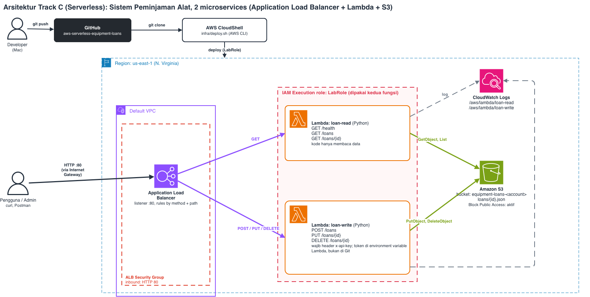

# Equipment Loans API (Serverless, Track C)

A small REST API for recording equipment loans, built as two serverless microservices on AWS.
Individual project for the Cloud Computing course (Track C: Serverless).

| | |
|---|---|
| Name | Bintang Khalifa Hadianto |
| Student ID (NIM) | 24/534951/TK/59312 |
| NIU | 534951 |
| Department | DTETI, Faculty of Engineering, Universitas Gadjah Mada |
| Environment | AWS Academy Cloud Foundations Sandbox, region `us-east-1` |

## 1. What it does

Borrowers and equipment (projector, camera, laptop, ...) are recorded as **loans**.
A loan has an equipment name, a borrower, a loan date, an optional return date and a status
(`borrowed` or `returned`). The API supports the four CRUD operations over HTTP and keeps the
data in AWS storage, so it is still there after the functions restart.

## 2. Architecture



The diagram source is in `docs/` (`.drawio`, open it with https://app.diagrams.net).

The API is split into **two microservices**, deployed as two separate Lambda functions:

| Microservice | Lambda function | Endpoints | Why separate |
|---|---|---|---|
| Read | `loan-read` | `GET /health`, `GET /loans`, `GET /loans/{id}` | Public, read-only, most traffic |
| Write | `loan-write` | `POST /loans`, `PUT /loans/{id}`, `DELETE /loans/{id}` | Changes data, needs the API token |

If `loan-write` breaks, `loan-read` keeps working (shown in the failure/recovery test).

### AWS services

The slide suggests API Gateway + Lambda + DynamoDB. Because the sandbox only allows a fixed list of
services, the deployment script supports an equivalent alternative:

| Role | Planned (as in the slide) | Alternative (equivalent) |
|---|---|---|
| API entry point | Amazon API Gateway (HTTP API) | Application Load Balancer with Lambda targets |
| Compute | AWS Lambda (Python) x 2 | AWS Lambda (Python) x 2 |
| Storage | Amazon DynamoDB (table `loans`) | Amazon S3 (one JSON object per loan) |
| Logs | Amazon CloudWatch Logs | Amazon CloudWatch Logs |
| IAM | `LabRole` (execution role) | `LabRole` (execution role) |

> **As-built:** _fill in after deployment: which variant was deployed, and the base URL._

## 3. API

Base URL: `https://<api-id>.execute-api.us-east-1.amazonaws.com` (API Gateway) or
`http://<alb-dns-name>` (ALB). Bodies are JSON.

| Method | Path | Service | Auth | Success | Description |
|---|---|---|---|---|---|
| GET | `/health` | loan-read | none | 200 | Service check |
| GET | `/loans` | loan-read | none | 200 | List all loans |
| GET | `/loans/{id}` | loan-read | none | 200 | One loan (404 if missing) |
| POST | `/loans` | loan-write | `x-api-key` | 201 | Create a loan |
| PUT | `/loans/{id}` | loan-write | `x-api-key` | 200 | Update fields of a loan |
| DELETE | `/loans/{id}` | loan-write | `x-api-key` | 200 | Delete a loan |

### Data entity: `loan`

| Field | Type | Notes |
|---|---|---|
| `id` | string | UUID, generated by the service |
| `equipment_name` | string | required, max 100 characters |
| `borrower_name` | string | required, max 100 characters |
| `loan_date` | string | required, `YYYY-MM-DD` |
| `return_date` | string or null | `YYYY-MM-DD`; set automatically when status becomes `returned` |
| `status` | string | `borrowed` (default) or `returned` |
| `created_at`, `updated_at` | string | UTC timestamps, set by the service |

### Examples

```bash
# create
curl -X POST "$BASE_URL/loans" -H "Content-Type: application/json" -H "x-api-key: $API_TOKEN" \
  -d '{"equipment_name":"Proyektor Epson","borrower_name":"Bibin","loan_date":"2026-11-26"}'

# list and read
curl "$BASE_URL/loans"
curl "$BASE_URL/loans/<id>"

# update (mark as returned)
curl -X PUT "$BASE_URL/loans/<id>" -H "Content-Type: application/json" -H "x-api-key: $API_TOKEN" \
  -d '{"status":"returned"}'

# delete
curl -X DELETE "$BASE_URL/loans/<id>" -H "x-api-key: $API_TOKEN"
```

Error responses are JSON: `{"error": "..."}` with status 400 (bad input), 401 (missing or wrong
token), 404 (not found), 405 (wrong method for the service) or 500 (server problem).

## 4. Repository layout

```
src/
  shared/        HTTP parsing/responses, validation rules, storage (DynamoDB or S3)
  loan_read/     handler.py  - read microservice
  loan_write/    handler.py  - write microservice
tests/
  test_api.py          unit tests (moto fakes DynamoDB and S3)
  smoke_test.sh        end-to-end test of the deployed API
  persistence_test.sh  data must survive a restart
infra/
  deploy.sh            creates everything (AWS CLI)
  teardown.sh          deletes everything
  build.py             packages the two Lambda zips
  failure_demo.sh      break / restore loan-write
  restart_functions.sh forces a cold start of both functions
  lambda_env.py        helper to change Lambda environment variables
docs/                  diagram, deployment plan, evidence checklist, demo script
evidence/              screenshots and test outputs
```

## 5. Run the tests locally

```bash
pip install -r requirements-dev.txt
pytest -v
```

## 6. Deploy to the AWS Academy sandbox

Run in AWS CloudShell (or the sandbox Lab IDE terminal):

```bash
git clone <this-repo-url> && cd <repo-folder>

./infra/deploy.sh                                    # API Gateway + DynamoDB (as in the slide)
# if DynamoDB is blocked:   STORAGE_BACKEND=s3 ./infra/deploy.sh
# if API Gateway is blocked: API_FRONT=alb STORAGE_BACKEND=s3 ./infra/deploy.sh
```

The script uses the existing `LabRole` (new IAM roles cannot be created in the sandbox).
The full step-by-step plan is in [`docs/deployment-plan.md`](docs/deployment-plan.md).

## 7. Test the deployment

```bash
./tests/smoke_test.sh | tee evidence/smoke-test-output.txt
./tests/persistence_test.sh write
./infra/restart_functions.sh
./tests/persistence_test.sh check | tee evidence/persistence-output.txt
```

## 8. Security and observability

- **No secrets in Git.** The API token is created by `deploy.sh`, stored in `~/.loans_token`
  outside the repository, and set only as an environment variable of `loan-write`.
  `.gitignore` also blocks `.env`, `*.pem` and `*.ppk`.
- **Write endpoints require `x-api-key`.** The check uses a constant-time comparison and fails
  closed (HTTP 500) if the token is not configured. Read endpoints are public because the
  sample data is not sensitive.
- **Input validation:** required fields, text length, `YYYY-MM-DD` dates, allowed statuses;
  the `id` cannot be changed.
- **IAM:** both functions use `LabRole`. This is broader than least privilege, but the sandbox does
  not allow creating roles. In a real account each function would get its own role: read-only
  access for `loan-read` and write access for `loan-write`.
- **Storage:** DynamoDB is reachable only through IAM. The S3 bucket (alternative) has Block
  Public Access turned on.
- **Network (ALB variant only):** the ALB security group allows inbound HTTP (port 80) only.
- **Logs and monitoring:** each request writes one JSON log line (service, method, path, status)
  to CloudWatch Logs (`/aws/lambda/loan-read`, `/aws/lambda/loan-write`). Tokens are never logged.

## 9. Failure and recovery scenario

```bash
./infra/failure_demo.sh break      # loan-write now points at storage that does not exist
./tests/smoke_test.sh              # writes return HTTP 500, reads still return 200
./infra/failure_demo.sh restore    # correct storage settings put back
./tests/smoke_test.sh              # everything passes again
```

This shows the benefit of splitting the API into two microservices: the failure is limited to
the write side.

## 10. Cleanup

```bash
./infra/teardown.sh
```

Deletes the API Gateway/ALB, Lambda functions, log groups, DynamoDB table or S3 bucket. The
sandbox also removes all resources when the session ends.

## 11. Status

- [ ] Week 12: design, diagram, starter code, deployment plan, initial AWS connectivity verified
- [ ] Week 14: full CRUD deployed, tests, evidence, demo video

## 12. Known limitations and trade-offs

- Lambda Function URLs and API keys on API Gateway were not used; a shared token in a header is the
  simplest protection that fits the sandbox.
- Listing loans scans the whole table (or bucket prefix). That is fine for a demo, not for large data.
- One shared `LabRole` instead of one role per function (sandbox restriction).
- The sandbox is cleaned at the end of each session, so the deployment is rebuilt with one command.
